<p align="center"></p>

<h1 align="center">r1metal: custom firmware for the Rabbit R1</h1>

<p align="center">Rabbit OS out. Linux and one fast Rust program (direct to hardware) in, and the whole firmware is<br><b>under 15 MB</b><br>YES YOU READ THAT RIGHT!<br>Your Rabbit R1 becomes a quick, quiet AI companion that runs on your own OpenAI key.</p>

<p align="center"><b>Stage</b> · One large icon at a time</p>
<p align="center">
  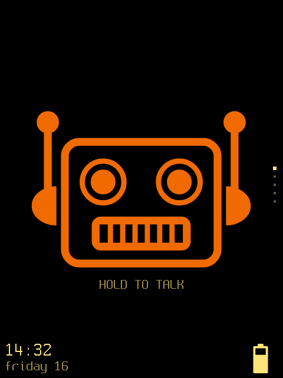
  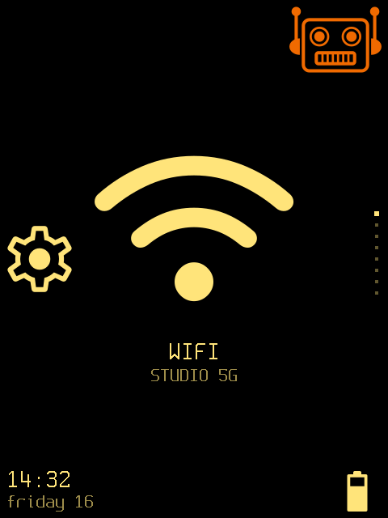
  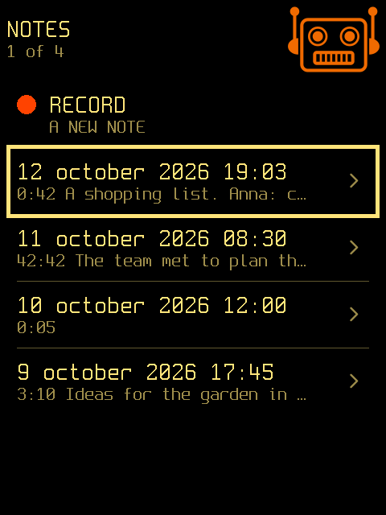
  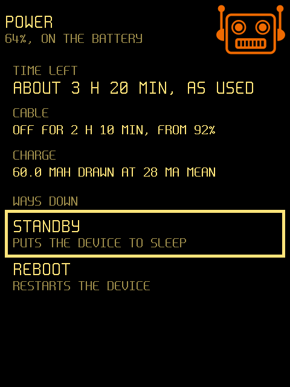
  
  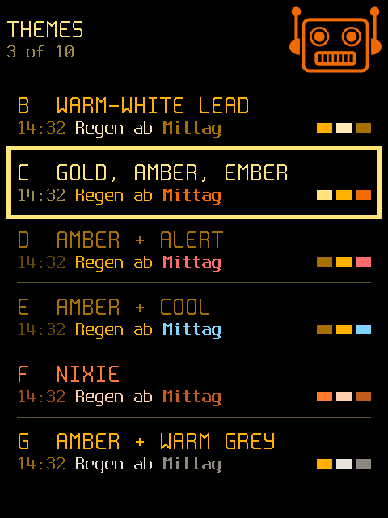
  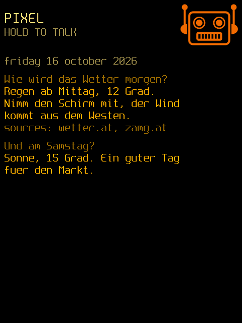
</p>

<p align="center"><b>Dial</b> · The wheel rolls everything</p>
<p align="center">
  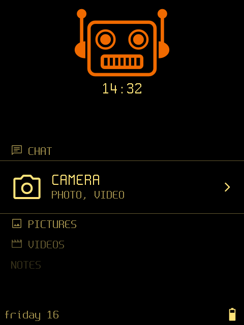
  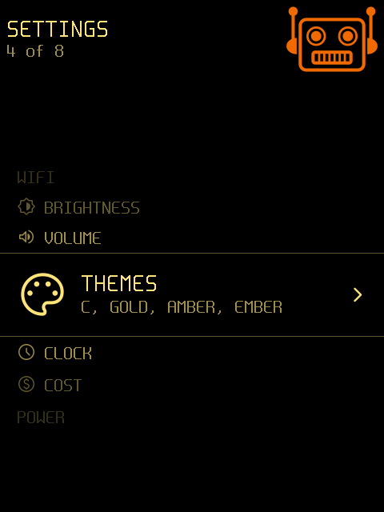
  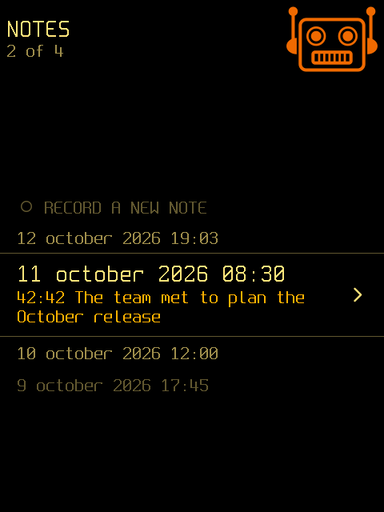
  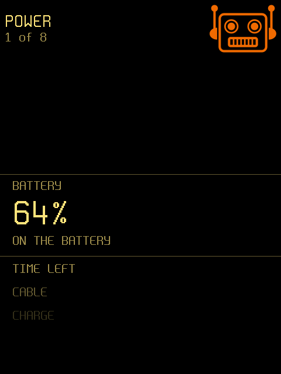
  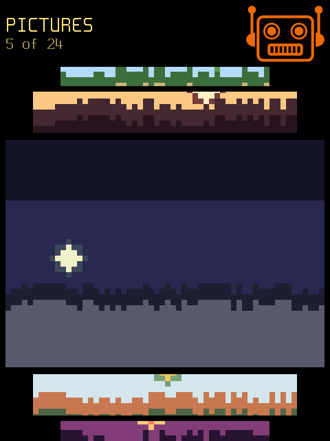
  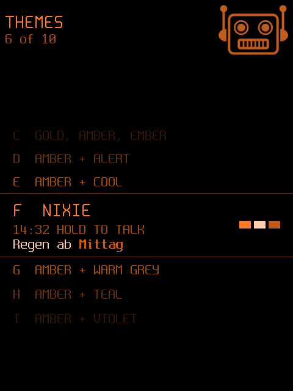
  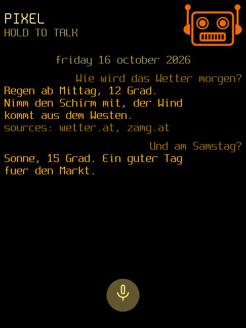
</p>

<p align="center"><b>Deck</b> · Everything on a card</p>
<p align="center">
  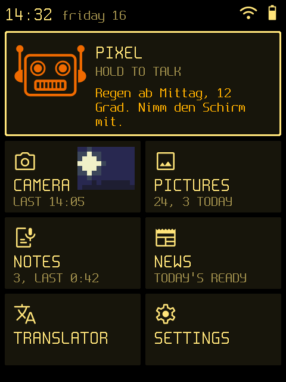
  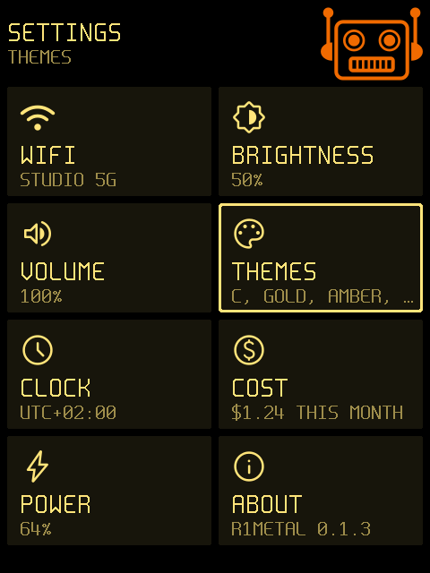
  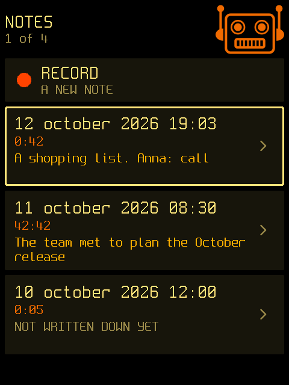
  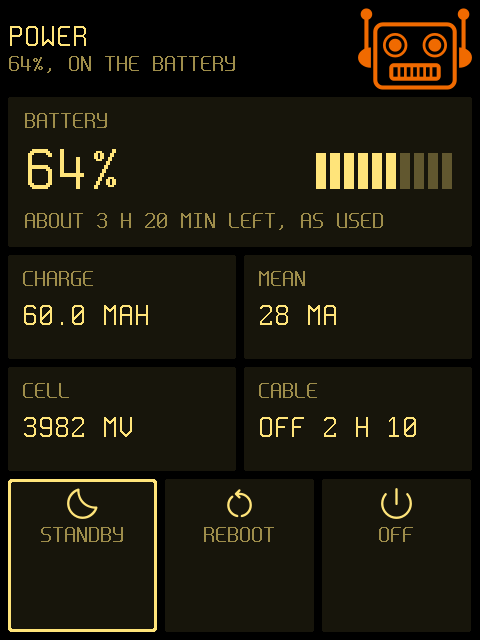
  
  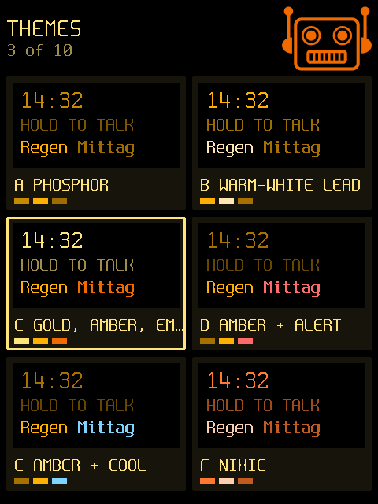
  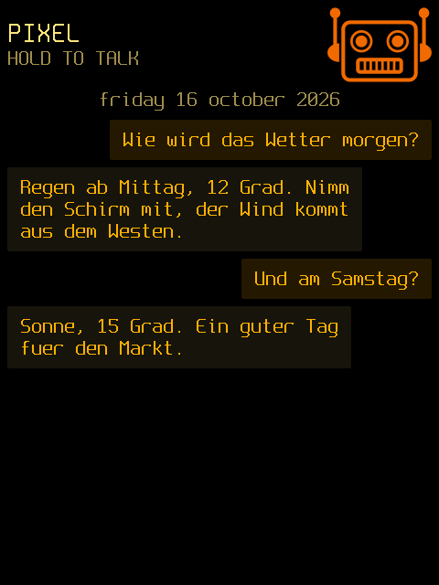
</p>

<p align="center"><b>Terminal</b> · Menus made of type</p>
<p align="center">
  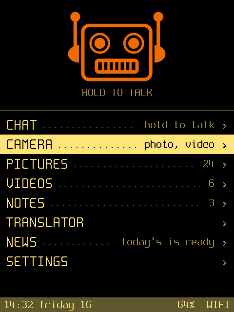
  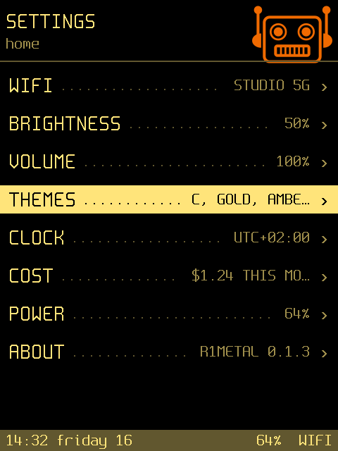
  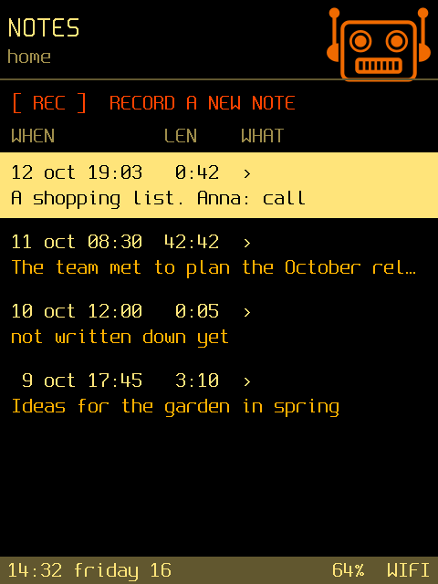
  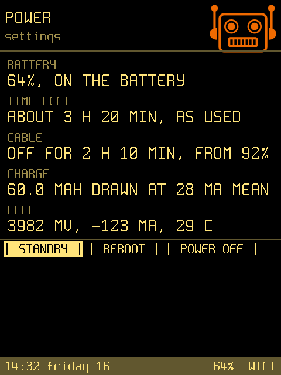
  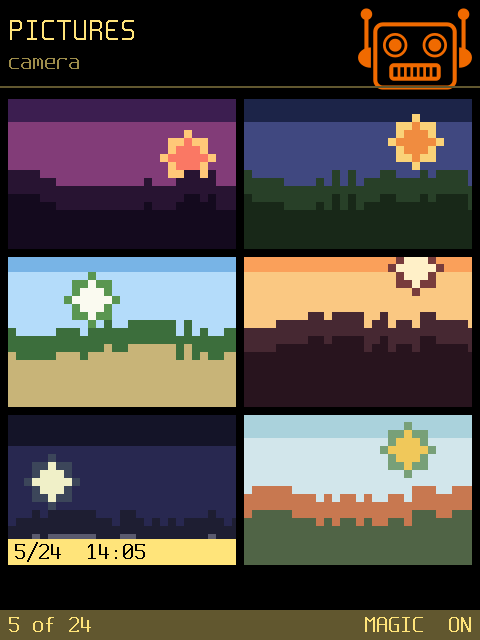
  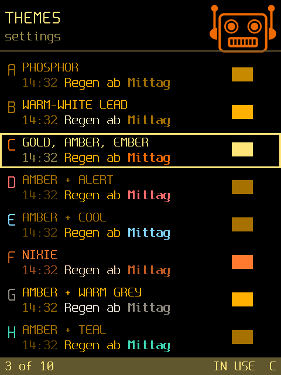
  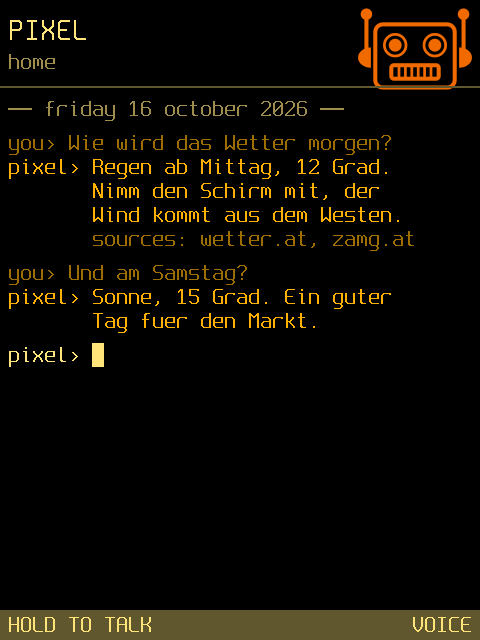
</p>

<p align="center"><b>Companion</b> · The robot leads</p>
<p align="center">
  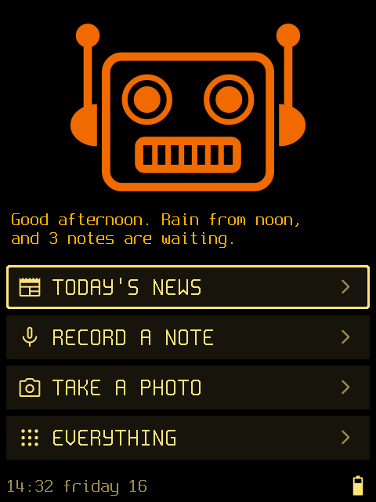
  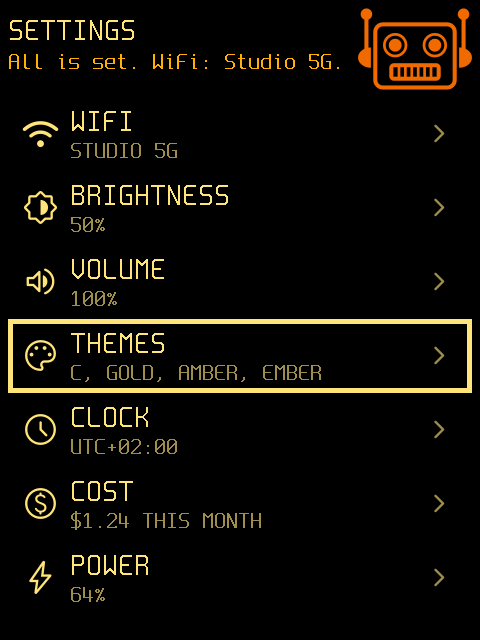
  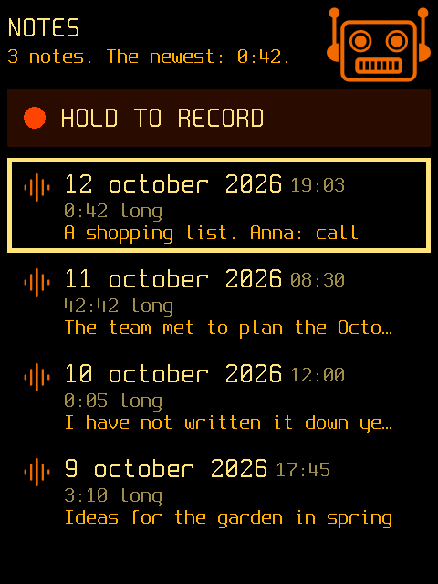
  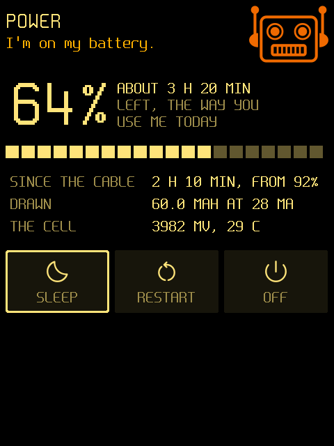
  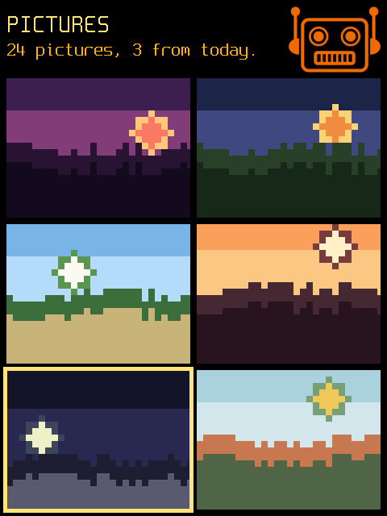
  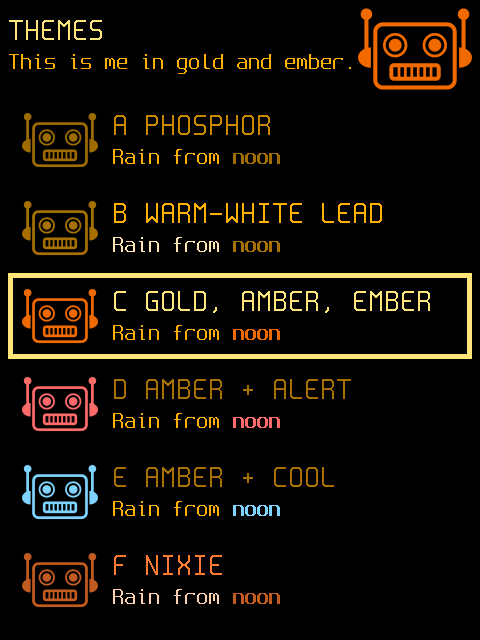
  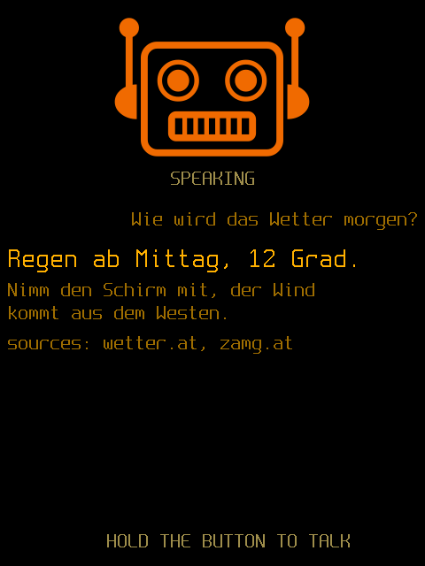
</p>
<p align="center"><sub>Five themes, ten color palettes each</sub></p>

## What you get

- **60 frames a second, everywhere. Every screen, every scroll of the wheel.**
- **A week on standby. Days of normal use on a charge.**
- **An AI that knows you.** One endless conversation that searches the web, remembers you, opens screens when you ask and answers aloud.
- **Voice notes.** Recorded, transcribed, summarized, saved as Markdown and PDF.
- **Live translator** between two languages.
- **A real camera.** 2048×2048 photos, 720p video at 60 fps with sound, and any photo redrawn as pixel art in about 13 seconds.
- **A morning paper.** A daily edition of news and finance from 47 sources.
- **Your files on your computer.** Plug the R1 in and it shows up as a drive.
- **No subscription.** You pay OpenAI only for what you use.
- **Rabbit OS is one command away**, whenever you want it back.

## Controls

- **Wheel:** scroll.
- **Push-to-talk button:** press to open, hold to talk.
- **Swipe in from the left:** back. **From the top:** home.
- **The robot:** when its antennas blink, tap it for what fits the screen: read a text aloud, mute the chat and type instead, switch a photo between pixel art and the real shot.
- **Sleep:** after 2 minutes untouched, nothing to configure. Press the button to wake.

## How?

Linux 4.19, from Rabbit's published source with 257 patches of our own, drives the hardware. One static Rust program is the whole system: `/init`, process 1. No Android, no shell, no vendor libraries. It programs the camera and the codecs register by register and draws every pixel itself. All of it is built with LLVM 23.1 for the R1's Cortex-A53: the program by Rust 1.99 at `opt-level = 3` with full LTO into one codegen unit, its C by clang at `-O3`, the kernel with ThinLTO.

That fixes what held the R1 back:

- **64-bit throughout.** Kernel and program are arm64, 32-bit support compiled out. Rabbit OS still ran its video codec as 32-bit code.
- **Wi-Fi that works.** 2.4 and 5 GHz, WPA2 and WPA3, with our own scans and handshakes straight over the kernel. Online 0.7 s after it is needed.
- **60 fps on the CPU.** The GPU stays off. The panel runs at a true 60 Hz instead of 57.4, and only what changed is drawn again.
- **A camera without lag.** Rust drives the sensor and the image pipeline, with our own exposure, white balance and color. The viewfinder runs at 60 fps, and a photo is saved in under a second.
- **Hardware H.264.** Our own H.264 on the R1's hardware encoder and decoder records 720p60 and plays at 60 fps. Photos are hardware JPEG.
- **A week on standby.** Every part is powered only for the seconds it is needed. Asleep the R1 draws 2 mA.

As a side project, `r1` came about: a flasher that flashes and restores the R1 hassle-free from macOS or Linux, one file with nothing else to install. Its commands are in [cli.md](cli.md).

The kernel patches and configuration are in [`kernel/`](kernel). The full source follows.

## Install

You need a Rabbit R1, a USB-C cable, a Mac or a Linux computer, and an [OpenAI API key](https://platform.openai.com/api-keys).

**1. Unlock the bootloader.** In Rabbit OS, turn on developer mode, then unlock the bootloader under device modification ([Rabbit's guide](https://www.rabbit.tech/support/article/unlock-bootloader-rabbit-r1)).

**2. Download** the two images, and `r1` for your computer saved as `r1`:

```sh
base=https://github.com/nesdeq/r1metal-rabbit-r1/releases/latest/download
curl -LO $base/boot.img -LO $base/dtbo.img
```

- **macOS:**

  ```sh
  curl -L -o r1 $base/r1-macos
  chmod +x r1
  xattr -c r1
  ```

  `xattr -c` keeps macOS from offering to move `r1` to the Trash. Then set System Settings › Privacy & Security › Security › Allow accessories to connect › **Automatically When Unlocked**.
- **Linux** (on arm64, take `r1-linux-arm64`):

  ```sh
  curl -L -o r1 $base/r1-linux-x86_64
  chmod +x r1
  ```

  Then let your user reach the R1 over USB:

  ```sh
  sudo curl -L -o /etc/udev/rules.d/70-r1metal.rules https://raw.githubusercontent.com/nesdeq/r1metal-rabbit-r1/main/udev/70-r1metal.rules
  sudo udevadm control --reload-rules
  ```

**3. Flash.** Turn the R1 off, run this, then plug the R1 in:

```sh
./r1 flash boot.img --overlay dtbo.img
```

Paste your OpenAI key when asked; `r1` checks it and puts it on the R1. The first flash erases the R1. When `r1` is done, the R1 starts r1metal.

**4. Join your Wi-Fi** under Settings › WiFi.

**No key at hand?** Press Enter instead. The R1 then asks for it in a window: join your Wi-Fi from there, choose **SCAN QR CODE**, run `./r1 key --qr`, paste your key and hold the R1's camera to the code.

**5. Charge the R1 to full once** on r1metal, and you're done. The battery level adapts to your R1's battery, and the first full charge calibrates it; until then the battery icon shows no level.

## Back to Rabbit OS

Download [Rabbit's stock firmware](https://github.com/rabbit-hmi-oss/firmware/releases/tag/v0.8.293), unzip it, and run:

```sh
./r1 restore --stock rabbit_OS_v0.8.293_20250516110545
```

[cli.md](cli.md) lists everything else `r1` can do.

---

<sub>r1metal is an independent project, not affiliated with or endorsed by Rabbit Inc. Rabbit and R1 are trademarks of Rabbit Inc.; OpenAI is a trademark of OpenAI.</sub>
